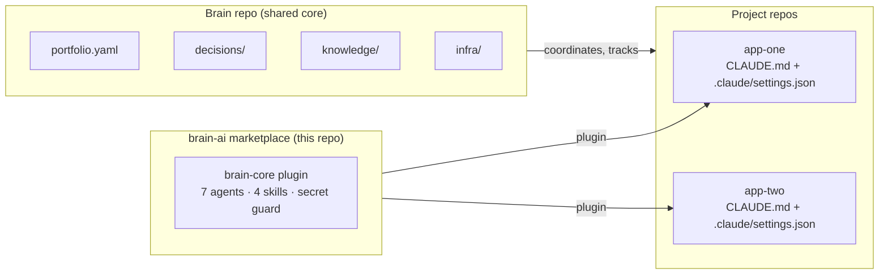

# brain-ai

A shared knowledge core, a project kit and a Claude Code plugin marketplace for running software projects with a small team of AI agents. Version 4 is a rewrite driven by 60 days of usage data.

> Looking for the earlier file-based framework with 19 agent personas? It lives at tag [`v3.0.0`](https://github.com/laszewskimariusz/brain-ai/tree/v3.0.0). Why it changed: [docs/why-v4.md](docs/why-v4.md).

## v3 → v4 in numbers

Measured over 60 days of real work (110 main sessions, 553 subagent runs):

| Finding | Decision in v4 |
|---|---|
| Subagents caused **80 %** of cache-creation tokens and **76 %** of output tokens; most calls inherited the most expensive model | every agent pins its model; only the architect runs on the strongest one |
| **6 of 18** agent personas were never called | 7 role agents, no personas ([persona prompts do not improve results](https://arxiv.org/abs/2311.10054)) |
| A custom manifest and search index were read **~28 times** in 60 days, regenerated **~44 times** | removed; plain files and `grep` |
| A frontmatter-format hook blocked **0** writes; the secret guard blocked **8** real leaks | keep only guards that bite, ship them in the plugin |
| **0** sessions started inside a project repo | each project gets its own kit; the brain only coordinates |
| Agents were copied between machines and drifted apart | one versioned plugin installed from one marketplace |

Result of the slimming: context loaded at session start went from **81k to 40k tokens (−50 %)**.

## How it fits together



- **Brain** — what is shared across projects: infrastructure, decisions, research, the portfolio. Small `CLAUDE.md` (< 2 KB), no project code.
- **Project repos** — code plus a kit: a short `CLAUDE.md` and `.claude/settings.json` that enables the plugin and denies secret reads.
- **Marketplace** — agents, skills and guards ship as one versioned Claude Code plugin instead of files copied around.
- **Two machines** — a coordinator session plans and tracks; heavy builds, tests and parallel agents run on a separate build machine.

Details: [docs/architecture.md](docs/architecture.md).

## Quick start

In Claude Code, inside any project:

```
/plugin marketplace add laszewskimariusz/brain-ai
/plugin install brain-core@brain-ai
```

Then set the project up:

```
/brain-core:project-init
```

It writes `CLAUDE.md` and `.claude/settings.json` (template: [project-kit/](project-kit/)). For the shared core, copy [brain-template/](brain-template/) into its own repo and list your projects in `portfolio.yaml`:

```
pip install pyyaml
python3 scripts/portfolio_status.py brain-template/portfolio.yaml
```

The kit pins the release it was set up with: `extraKnownMarketplaces.brain-ai.source.ref` is the release tag (for example `"ref": "v4.0.1"`), so a project keeps the agents and guard it was tested with until you move it on purpose.

## Updating

1. In this repo: bump `version` in `plugins/brain-core/.claude-plugin/plugin.json`, add the `CHANGELOG.md` entry and set `ref` in `project-kit/.claude/settings.json` to the new tag (the tests fail until they match).
2. Merge, tag `vX.Y.Z` and publish the GitHub release.
3. In each project: set `ref` in `.claude/settings.json` to the new tag. On a machine that already has the marketplace, re-add it at that tag and reinstall:

   ```
   /plugin marketplace remove brain-ai
   /plugin marketplace add laszewskimariusz/brain-ai@vX.Y.Z
   /plugin install brain-core@brain-ai
   ```

## What is in the plugin

| Agent | Model | Use it for |
|---|---|---|
| `architect` | opus | options with trade-offs, ADRs, data models, contracts |
| `developer` | sonnet | features and fixes, test-first, evidence from test runs |
| `reviewer` | sonnet | fresh-context review; read-only (tool list + hook) |
| `security` | sonnet | OWASP, secrets, dependencies, third-party repos; read-only (tool list + hook) |
| `devops` | sonnet | deploys, CI/CD, monitoring, rollbacks |
| `designer` | sonnet | UI, accessibility, responsive layouts |
| `researcher` | sonnet | primary-source research with citations; read-only (tool list + hook) |

Skills load on demand: `spec` (interview → spec), `test-plan`, `docs`, `project-init`.

Always-on cost of the whole plugin: **~580 tokens per session** (`claude plugin details brain-core@brain-ai`); an agent or skill body loads only when it fires.

The **secret guard** is a `PreToolUse` hook. It blocks writing literal secrets and known token shapes, reading `.env`/key files, copying them out and dumping the environment — and never echoes the value it caught. It runs at plugin level, so every agent gets it. It is a seat belt against honest mistakes, not the boundary: see [Security](#security).

`reviewer`, `security` and `researcher` are read-only first through their tool lists: none of them has `Write` or `Edit`, and `researcher` has no `Bash`. On top of that the hook makes a best-effort check of their shell commands: inside those agents it blocks `Write`/`Edit`/`MultiEdit`/`NotebookEdit` and shell commands that change files, git state or dependencies (redirects into files, `rm`, `mv`, `cp`, `sed -i`, `git commit`/`push`/`reset`/…, `npm install`, `pip install`, …). Reading, `git diff`/`log`/`show`, running tests and audits stay allowed. It reads `agent_type` from the hook input, so it applies inside those agents — as subagents, or in a session started with `claude --agent`. It parses commands with patterns: a script run through an interpreter (`python -c`, `node -e`) or a build step can still write, so treat it as a guard against accidents, not a sandbox.

## Repository layout

```
.claude-plugin/marketplace.json   marketplace "brain-ai"
plugins/brain-core/               agents/ skills/ hooks/ .claude-plugin/plugin.json
project-kit/                      CLAUDE.md + .claude/settings.json for a project
brain-template/                   shared core: CLAUDE.md, portfolio.yaml, decisions/, knowledge/, infra/
scripts/portfolio_status.py       latest commit + HTTP status for every project
docs/                             why v4, architecture, ADR, migration from v3
tests/                            pytest: manifests, agents, skills, secret guard, kit, docs
```

## Design decisions

- [ADR 0001 — Brain core, projects apart, agents as plugins](docs/adr/0001-brain-core-projects-plugins.md)
- [Why v4: the measurements](docs/why-v4.md)
- [Migrating from v3](docs/migrating-from-v3.md)

## Security

- Secrets never live in files: settings and docs hold key names only; values are read into a variable at runtime.
- Layers, strongest first: Bash sandbox (enforced by the OS) → `permissions.deny` (Claude's file tools) → secret guard hook (seat belt). The project kit turns the sandbox on and gives the sandbox and `permissions.deny` the same protected-path list the hook uses. Instructions in prompts enforce nothing.
- The sandbox covers shell commands only, and needs `bubblewrap` and `socat` on Linux; without them Claude Code runs commands unsandboxed, so install them (or set `sandbox.failIfUnavailable` to refuse to start without them).
- The kit sets `sandbox.autoAllowBashIfSandboxed` to `false`: turning the sandbox on does not change who approves commands. When the sandbox blocks a command, Claude may ask to rerun it outside the sandbox; that rerun needs your approval. Set `sandbox.allowUnsandboxedCommands` to `false` to remove the escape hatch entirely.
- Credential stores that tools read themselves (`.netrc`, `.pgpass`, `.git-credentials`, `~/.aws/credentials`) are denied to Claude's file tools and the hook, not to the sandbox, so `git`, `psql` and cloud CLIs keep working there.
- Every push runs the tests, a private-pattern scan of the tree and history, and gitleaks.

## Limits

- Built for a small team (one owner plus agents). Larger teams will want a real issue tracker integration and access control.
- Agent prompts are tuned for Claude models; other harnesses read the skills but not the hooks.
- The numbers above come from one team's usage, not a benchmark.
- The hook's matcher covers `Write`, `Edit`, `MultiEdit`, `NotebookEdit`, `Read`, `Grep`, `Glob` and `Bash`; other tools (MCP servers, PowerShell) are not checked. Read-only roles are recognised by `agent_type` `brain-core:<name>` (or the bare name, for a copied agent).

## License

Apache-2.0. See [LICENSE](LICENSE) and [NOTICE](NOTICE).
