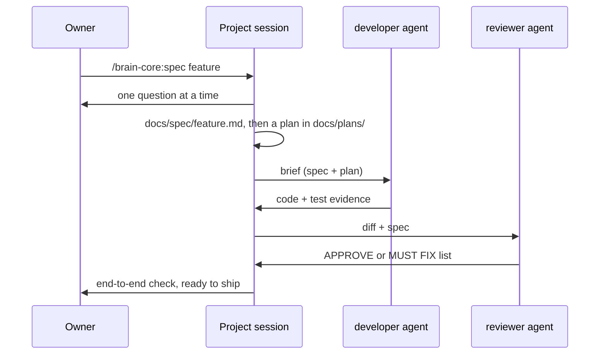

# Architecture

## Pieces

| Piece | Holds | Lives in |
|---|---|---|
| Brain | infrastructure notes, decisions (ADRs), research, `portfolio.yaml` | its own repo, cloned on the coordinator |
| Marketplace | the `brain-core` plugin: agents, skills, hooks | this repo (or your fork) |
| Project | code + kit (`CLAUDE.md`, `.claude/settings.json`, `docs/spec`, `docs/plans`) | one repo per project |
| Coordinator | the owner's main session: portfolio, cross-project decisions | a small, always-on machine |
| Build machine | working copies, builds, tests, parallel agents | a machine with CPU and memory to spare |

## Flow of a feature

## Why the split

- **Context stays small.** A project session loads that project's `CLAUDE.md` and the plugin's skill descriptions — not the whole brain.
- **One source of truth for agents.** Updating an agent means releasing a new plugin version (`plugin.json` + changelog); every project picks it up from the same marketplace instead of carrying its own copy.
- **Heavy work does not starve the coordinator.** Builds and fan-out run on the build machine.

## Guards

1. `permissions.deny` in every project kit: no reading `.env`, `.secrets`, key files; no `env`/`printenv`.
2. The plugin's `PreToolUse` secret guard: blocks literal secrets in writes, secret-file reads and environment dumps.
3. In CI: tests, a private-pattern scan of the tree and history, and gitleaks.
