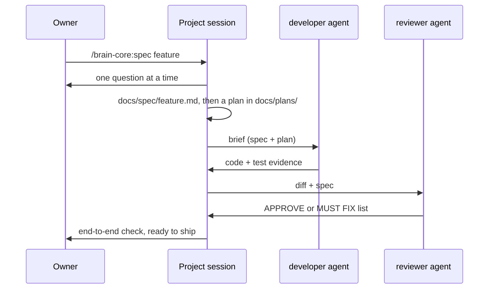

# Architecture

## Pieces

| Piece | Holds | Lives in |
|---|---|---|
| Brain | infrastructure notes, decisions (ADRs), research, `portfolio.yaml` | its own repo, cloned on the coordinator |
| Marketplace | the `brain-core` plugin: agents, skills, hooks | this repo (or your fork) |
| Project | code + kit (`CLAUDE.md`, `.claude/settings.json`, `docs/spec`, `docs/plans`) | one repo per project |
| Coordinator | the owner's main session: portfolio, cross-project decisions | a small, always-on machine |
| Build machine | working copies, builds, tests, parallel agents | a machine with CPU and memory to spare |

## Flow of a feature

## Why the split

- **Context stays small.** A project session loads that project's `CLAUDE.md` and the plugin's skill descriptions — not the whole brain.
- **One source of truth for agents.** Updating an agent means releasing a new plugin version (`plugin.json` + changelog); every project moves to it by bumping one `ref` instead of carrying its own copy.
- **Heavy work does not starve the coordinator.** Builds and fan-out run on the build machine.

## Guards

Layers: sandbox (OS) → `permissions.deny` → hook (seat belt). One list of protected paths (`PROTECTED` in `plugins/brain-core/hooks/secret_guard.py`) feeds all three; tests keep the kit in sync with it.

1. **Bash sandbox** (`sandbox.enabled` in the kit): the operating system limits what shell commands can read, write and reach. `sandbox.filesystem.denyRead` hides the protected paths from every command and the processes it starts. It does not cover Claude's own file tools, MCP servers or hooks.
2. **`permissions.deny`** in the kit: Claude's file tools cannot read the protected paths; no `env`/`printenv`.
3. **The plugin's `PreToolUse` secret guard**: blocks literal secrets in writes, secret-file reads, copying secret files out and environment dumps. It parses commands with patterns, so a determined caller can get around it; it catches honest mistakes, the layers above hold the line. It also adds a best-effort check that the read-only agents (`reviewer`, `security`, `researcher`), whose tool lists already exclude `Write`/`Edit`, do not change files or git state from the shell.
4. **In CI**: tests, a private-pattern scan of the tree and history, and gitleaks.
